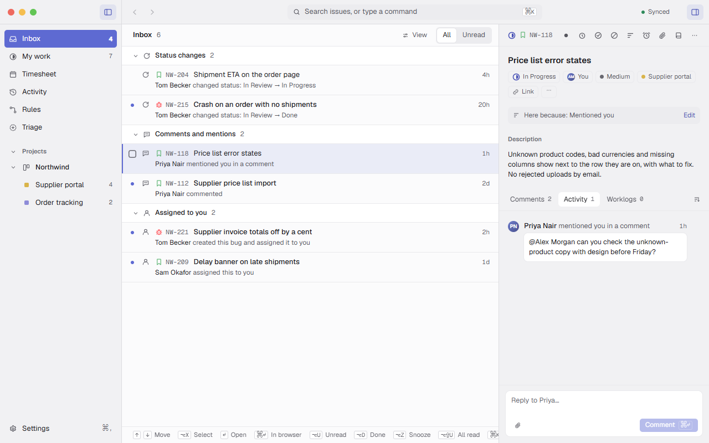
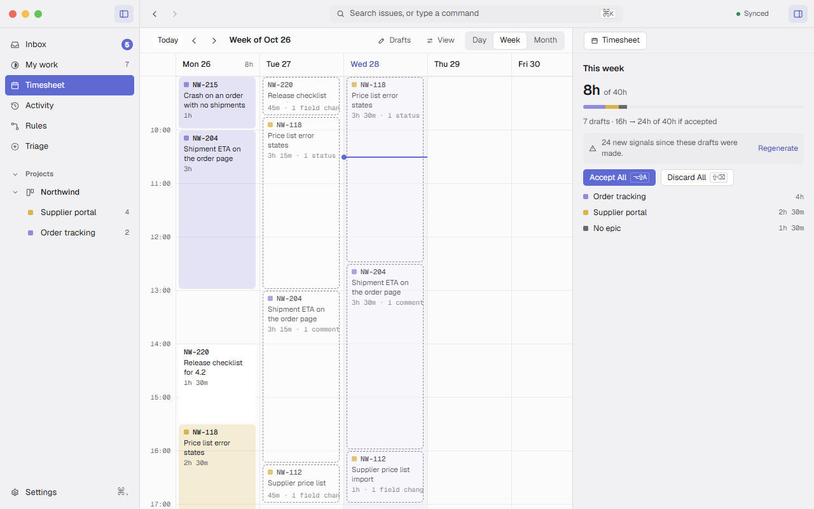

# Relay

A desktop app for managing your Jira issues: offline-first, with an Inbox that shows only what your rules send it, and a timesheet that fills itself from what you did.

**📖 Guide: [nicu.github.io/relay-releases](https://nicu.github.io/relay-releases/)**: how Relay works, with screenshots, from getting started to time tracking without timers.

### An Inbox of only what needs you

Every change in Jira is checked against your rules; only what they send to your Inbox shows there, each item saying why.

<picture>
  <source media="(prefers-color-scheme: dark)" srcset="https://github.com/nicu/relay-releases/raw/gh-pages/shots/inbox/inbox.dark.png">
  
</picture>

### Your timesheet, filled from what you did

No timers: your commits, comments and status moves become drafts on the Timesheet, each saying why it's there, and you accept them with one key.

<picture>
  <source media="(prefers-color-scheme: dark)" srcset="https://github.com/nicu/relay-releases/raw/gh-pages/shots/time-tracking/drafts-week.dark.png">
  
</picture>

This repository holds Relay's **releases** and **issues**. The source code is not here.

## Download

Get the latest version from [Releases](https://github.com/nicu/relay-releases/releases/latest):

- **macOS**: `Relay-darwin-arm64-<version>.zip` (Apple silicon). Unzip it and move **Relay** to Applications.
- **Windows**: `Relay-<version> Setup.exe`.
- **Linux**: the `.deb` (Debian, Ubuntu) or `.rpm` (Fedora, openSUSE) package.

Then follow [Getting started](https://nicu.github.io/relay-releases/getting-started) in the Guide.

## Updates

Relay checks this repository for new versions (Settings › General › Updates). It never downloads anything until you ask.

- **macOS**: Download puts the new zip in your Downloads folder. Quit Relay, unzip it, and replace the app in Applications.
- **Windows**: the update installs in place when you restart.
- **Linux**: Download opens the release page; install the package as you did the first one.

## Report a problem or suggest an idea

[Open an issue](https://github.com/nicu/relay-releases/issues/new/choose). In Relay, Help › Report an Issue… opens the same page.

Include your Relay version (Settings › About) and your OS. Logs help with bugs: Settings › About › Logs › Show in Finder.
